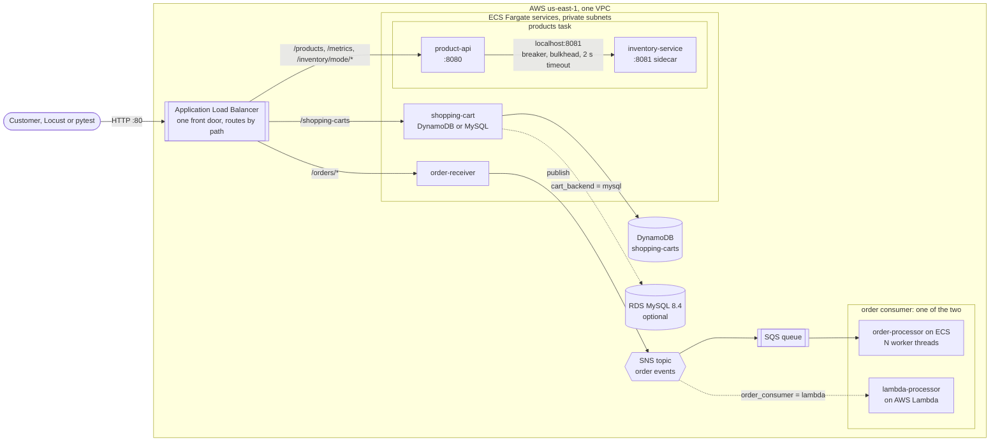
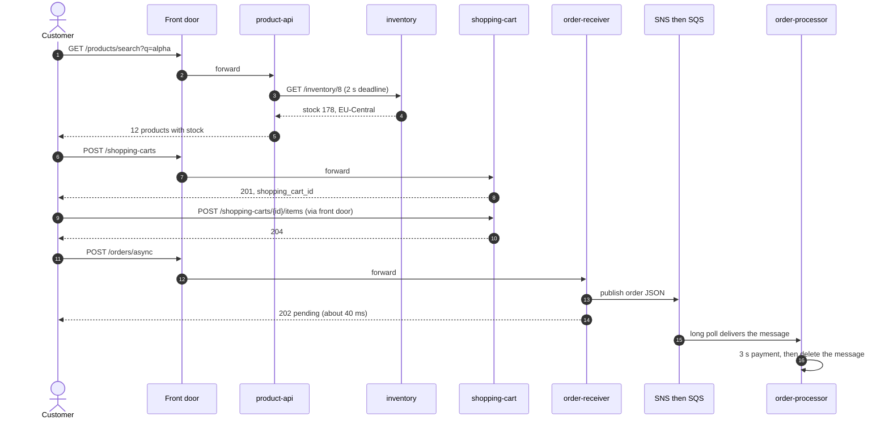
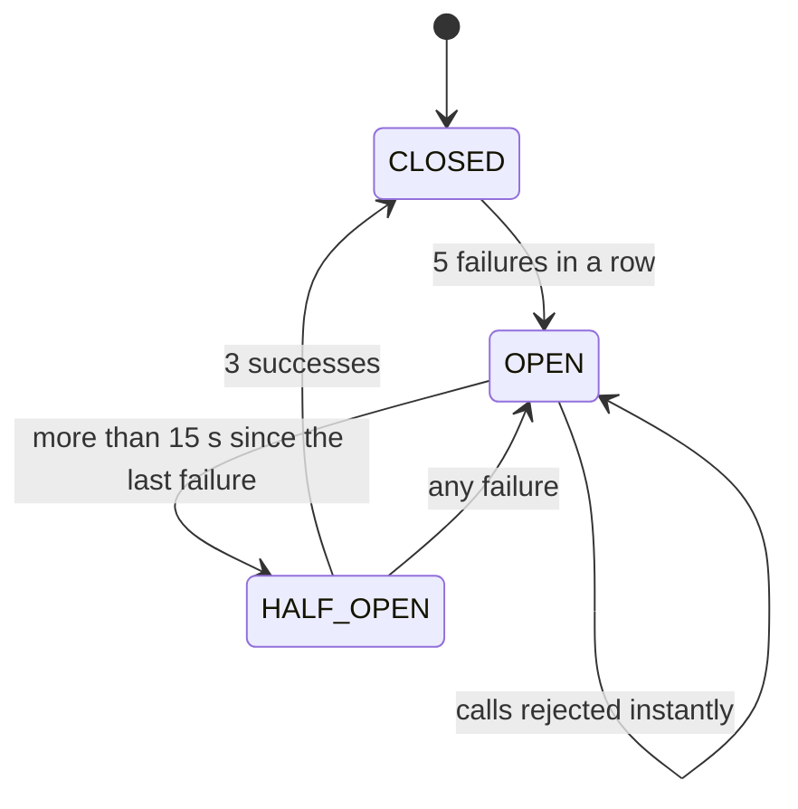
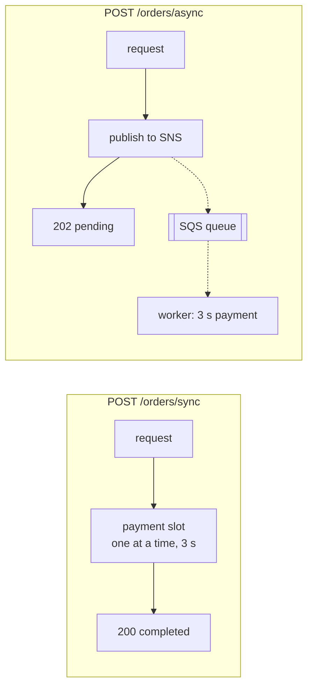
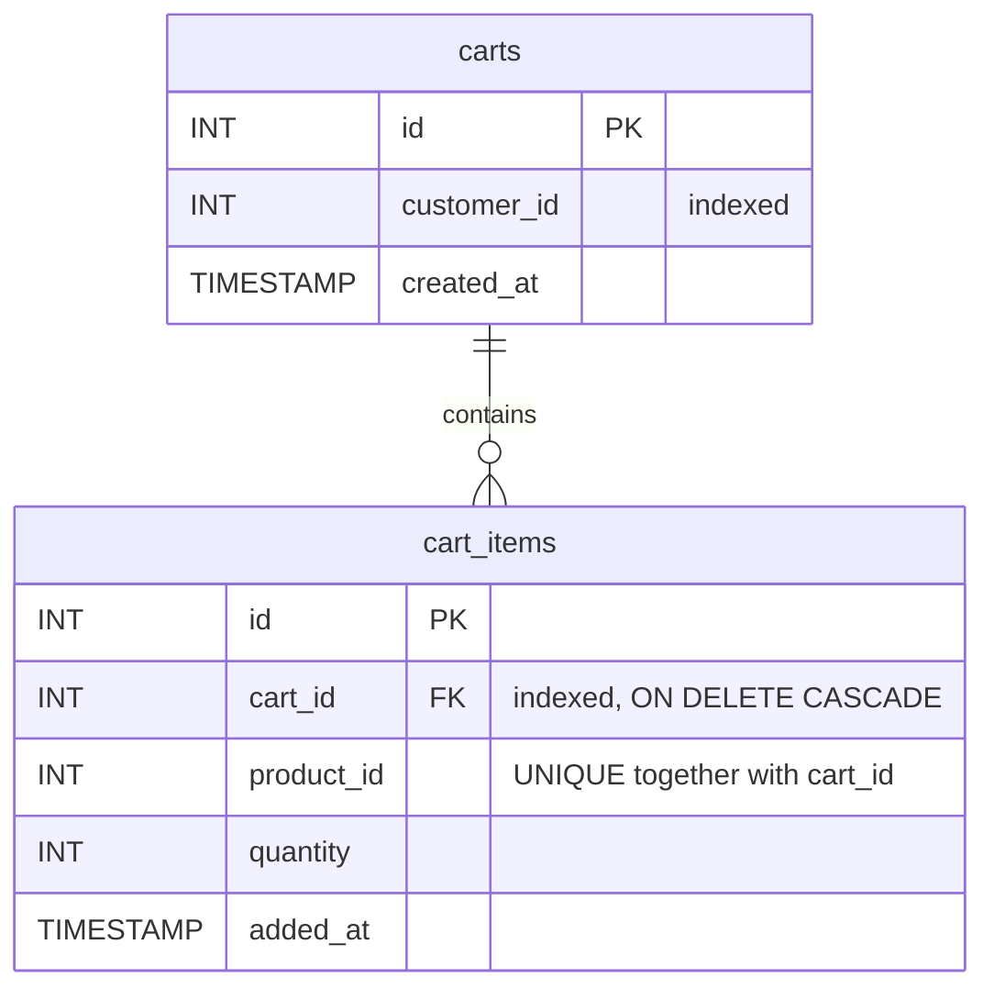

# Scalable Event-Driven Order Processing System


**Project at a Glance**
- Architected a 7-service, event-driven e-commerce platform with Java 21, Spring Boot, AWS, and Docker, serving a 100,000-product catalog through independently deployable microservices.
- Built a high-throughput asynchronous order pipeline using Amazon SNS, SQS, and ECS Fargate, sustaining 1,000 orders/second with zero message loss while decoupling checkout requests from payment processing.
- Engineered queue-aware auto-scaling for 2–10 ECS Fargate workers, using CloudWatch SQS queue-depth alarms to increase processing capacity during traffic spikes and scale back as backlogs cleared.
- Reduced P95 latency by 70% with Circuit Breaker, Bulkhead, and Fail-Fast patterns between product and inventory microservices, preserving availability through graceful degradation when inventory crashed.
- Implemented DynamoDB-backed idempotency keys to deliver exactly-once order-processing effects across retries and duplicate SQS deliveries, protecting order correctness under failure.
- Provisioned repeatable AWS infrastructure with Terraform across ECS, ALB, SNS/SQS, DynamoDB, IAM, and CloudWatch, with Docker Compose for end-to-end local development and validation.
- Benchmarked throughput and scaling with Python/Locust across worker configurations, and validated functionality with 240 automated tests (188 Java + 52 Python) spanning API contracts, service behavior, and end-to-end order flows.

The backend of an online store, built as small services on AWS. It shows the three problems every
growing store hits, and a working answer to each:

| Problem | What happens without a fix | What this project does |
|---|---|---|
| A slow dependency | one hanging stock service freezes the whole product page | **circuit breaker, bulkhead, fail-fast, graceful degradation** |
| A flash sale | customers wait 30+ s while payments run one at a time | **event-driven orders**: accept in ~40 ms, process later from a queue |
| Picking a database | SQL or NoSQL for shopping carts? | **both implemented and measured**: MySQL (RDS) vs DynamoDB |

Everything runs on your laptop with one command (`docker compose up`), and on AWS with one
`terraform apply`.

> Built step by step in **CS6650 Building Scalable Distributed Systems** (Northeastern University),
> then merged into one project and written in Java. See [docs/MIGRATION.md](docs/MIGRATION.md).

---

## Contents

1. [Architecture](#architecture)
2. [A customer's journey](#a-customers-journey)
3. [The services](#the-services)
4. [Key ideas, explained](#key-ideas-explained)
5. [Run it locally](#run-it-locally)
6. [Run the tests](#run-the-tests)
7. [Deploy to AWS](#deploy-to-aws)
8. [API reference](#api-reference)
9. [Experiments and results](#experiments-and-results)
10. [Project structure](#project-structure)
11. [Known limitations and next steps](#known-limitations-and-next-steps)

---

## Architecture



- **One front door.** The load balancer is the only public part. It sends each request to a service
  by its path, and answers `404` itself for anything else.
- **Private services.** Every service is a container on ECS Fargate in private subnets (no public IP).
  They reach AWS APIs through a NAT gateway, and DynamoDB through a VPC endpoint.
- **Two switches** in Terraform choose the variant: `cart_backend` (`dynamodb` or `mysql`) and
  `order_consumer` (`ecs` or `lambda`).

## A customer's journey



Try exactly this journey on your laptop in [Run it locally](#run-it-locally).

## The services

| Service | What it does | Main endpoints | Data | From |
|---|---|---|---|---|
| [product-api](services/product-api) | 100,000-product catalogue and search; asks inventory for stock through resilience patterns | `GET /products/{id}`, `GET /products/search?q=`, `POST /products/{id}/details`, `GET /metrics` | in memory | HW5, HW6, MM2 |
| [inventory-service](services/inventory-service) | stock per product; can be switched to *degraded* or *crashed* to test resilience | `GET /inventory/{id}`, `POST /mode/{healthy,degraded,crashed}`, `GET /stats` | computed | MM2 |
| [order-receiver](services/order-receiver) | takes orders, either waiting for payment (sync) or queueing them (async) | `POST /orders/sync`, `POST /orders/async` | none | HW7 |
| [order-processor](services/order-processor) | worker threads that long-poll SQS and process each order | `GET /health` only | none | HW7 |
| [lambda-processor](services/lambda-processor) | the same work as a Lambda function triggered by SNS | AWS Lambda handler | none | HW7 |
| [shopping-cart](services/shopping-cart) | carts in MySQL: one LEFT JOIN read, upsert, transaction | `POST /shopping-carts`, `GET /shopping-carts/{id}`, `POST /shopping-carts/{id}/items` | RDS MySQL | HW8 |
| [shopping-cart-dynamo](services/shopping-cart-dynamo) | the same API with each cart as one DynamoDB item | same as above, cart IDs are UUIDs | DynamoDB | HW8 |

Each service is a standalone Maven project with its own `Dockerfile`, and every one has `GET /health`.

## Key ideas, explained

<details>
<summary><b>Resilience: what happens when the inventory service breaks</b></summary>

The product page needs stock information from another service. If that service hangs, every product
request hangs with it, and a search that needs 12 stock lookups takes 12 × 10 s = 2 minutes. Three
guards in [`ResilientInventoryClient`](services/product-api/src/main/java/com/onlinestore/product/ResilientInventoryClient.java)
stop that:

1. **Bulkhead** ([`Bulkhead`](services/product-api/src/main/java/com/onlinestore/product/resilience/Bulkhead.java)):
   at most 10 calls to inventory at once. Extra callers are turned away immediately, so a slow
   dependency can't tie up every thread.
2. **Circuit breaker** ([`CircuitBreaker`](services/product-api/src/main/java/com/onlinestore/product/resilience/CircuitBreaker.java)):
   after 5 failures in a row it stops calling inventory for 15 s, then tests whether it has recovered.
3. **Fail fast**: every call has a 2 s deadline (connect, headers and body together).

If any guard says no, the product is still returned with `"stock": -1, "inventory_status":
"unavailable"`. That's **graceful degradation**: the page works, just without stock.



Try it locally: `python experiments/resilience/test_resilience.py` crashes inventory and shows
the response times drop from 2,000 ms (fail fast) to 3 ms (circuit open), then recover.
</details>

<details>
<summary><b>Event-driven orders: sync vs async</b></summary>

Payment verification takes 3 s and the payment provider handles one payment at a time. With a
**synchronous** endpoint the customer waits for all of it, and throughput is capped at 0.33 orders/s.
With the **asynchronous** endpoint the receiver only publishes the order and answers `202 Accepted`;
workers do the slow part later.



- **SNS** is a loudspeaker: it announces each order to every subscriber.
- **SQS** is a waiting line: orders wait there (up to 4 days) until a worker takes them, and a
  message is only deleted after it was processed, so a crashed worker loses nothing.
- **Scaling the workers** (`NUM_WORKERS`) drains the line faster: 60 orders/s with 3 s of work each
  needs 180 parallel workers.
</details>

<details>
<summary><b>ECS worker vs Lambda</b></summary>

| | ECS worker (default) | Lambda (`order_consumer = "lambda"`) |
|---|---|---|
| Path | SNS → SQS → worker | SNS → Lambda directly |
| Cost when idle | pays for the running task | free |
| Scaling | you choose the worker count | automatic, per message |
| Durability | SQS keeps messages for 4 days | SNS retries, then drops |

Only one consumer path is created at a time, so an order is never processed twice. The HW7 team
recommendation was **SNS → SQS → Lambda**: serverless cost with a queue's durability.
</details>

<details>
<summary><b>Shopping carts: MySQL vs DynamoDB</b></summary>

**MySQL**, two tables with a foreign key:



Reading a cart is a single `LEFT JOIN`. Adding a product uses `INSERT … ON DUPLICATE KEY UPDATE
quantity = quantity + VALUES(quantity)` inside a transaction, so adding the same product twice adds
up its quantity instead of creating a duplicate row.

**DynamoDB**, one item per cart (partition key `cart_id`):

```json
{ "cart_id": "1bd2658d-…", "customer_id": 42, "created_at": "2026-03-23T04:00:24Z",
  "items": [ { "product_id": 8, "quantity": 2, "added_at": "2026-03-23T04:00:30Z" } ] }
```

Reading is one `GetItem`. Adding reads the cart, changes it in memory and writes it back. In the
HW8 tests both were equally fast (about 70 ms, 100% success); DynamoDB is the default because there's
no server to run or pay for while idle.
</details>

## Run it locally

You only need **Docker**. Java and Maven run inside the image builds.

```bash
git clone https://github.com/piyush1420/Scalable-Event-Driven-Order-Processing-System.git
cd Scalable-Event-Driven-Order-Processing-System
docker compose up --build -d        # a few minutes the first time (downloads images, builds 6 services)
docker compose ps                   # wait until the services say "healthy"
```

AWS is emulated by [moto](https://github.com/getmoto/moto) (SNS, SQS, DynamoDB), MySQL runs in a
container, and nginx plays the load balancer on port 8000.

| Port | What |
|---|---|
| 8000 | front door (routed like the AWS load balancer) |
| 8080 / 8081 | product-api / inventory-service |
| 8082 / 8083 | MySQL cart / DynamoDB cart (the front door uses DynamoDB) |
| 8084 / 8085 | order-receiver / order-processor (health only) |

**Walk the customer journey:**

```bash
curl "localhost:8000/products/search?q=alpha"                       # 12 products with stock

curl -X POST localhost:8000/shopping-carts \
     -H 'Content-Type: application/json' -d '{"customer_id": 42}'    # -> {"shopping_cart_id":"<id>"}

curl -X POST localhost:8000/shopping-carts/<id>/items \
     -H 'Content-Type: application/json' -d '{"product_id": 8, "quantity": 2}'
curl localhost:8000/shopping-carts/<id>

curl -X POST localhost:8000/orders/async -H 'Content-Type: application/json' \
     -d '{"customer_id":42,"items":[{"product_id":"8","name":"Product Alpha 8","quantity":2,"price":19.99}]}'
docker compose logs -f order-processor                              # watch the worker process it
```

**Break things on purpose:**

```bash
curl -X POST localhost:8000/inventory/mode/crashed     # inventory now hangs 10 s per call
curl localhost:8000/products/1                         # still answers after 2 s: "inventory_status":"unavailable"
curl localhost:8000/metrics                            # after 5 failures: "state":"OPEN"
curl -X POST localhost:8000/inventory/mode/healthy     # recovers about 15 s later
```

Stop everything with `docker compose down`.

## Run the tests

| What | Command | Needs |
|---|---|---|
| Java unit and HTTP tests (188) | `./mvnw verify` | JDK 21+ |
| MySQL repository against real SQL | `TEST_MYSQL_URL=jdbc:mysql://localhost:3307/cart_test TEST_MYSQL_PASSWORD=… ./mvnw -pl services/shopping-cart test` | a throwaway MySQL |
| Python API tests (52): smoke, contract, end-to-end, consistency | `pip install -r tests/requirements.txt && pytest` | the running stack |
| Same tests against AWS | `STORE_URL=$(terraform -chdir=terraform output -raw store_url) pytest` | a deployment |
| Consistency report (HW8 style) | `python tests/test_consistency.py` | the running stack |

<details>
<summary>What each Python test file covers</summary>

- [`tests/test_smoke.py`](tests/test_smoke.py): every route behind the front door answers.
- [`tests/test_api_contract.py`](tests/test_api_contract.py): exact status codes and error messages
  for valid and invalid input on every endpoint.
- [`tests/test_end_to_end.py`](tests/test_end_to_end.py): browse, then cart, then order, then sync checkout.
- [`tests/test_consistency.py`](tests/test_consistency.py): does a read right after a write see it?
  (DynamoDB reads are eventually consistent.)
</details>

<details>
<summary>The original course experiments</summary>

The scripts in [`experiments/`](experiments) are the ones used for the reports and still work:

| Folder | Script | Run against |
|---|---|---|
| `product-search-load` | Locust search load test | `locust -f experiments/product-search-load/locustfile.py --host http://localhost:8000` |
| `resilience` | crash/recover walkthrough | `python experiments/resilience/test_resilience.py` (uses ports 8080 and 8081) |
| `sync-vs-async-orders` | Locust flash sale (`OrderUser` sync, `AsyncOrderUser` async) | `locust -f experiments/sync-vs-async-orders/locustfile.py --host http://localhost:8000` |
| `mysql-vs-dynamodb` | 150 operations per database, then compare | `BASE_URL=http://localhost:8082 python test_mysql.py`, `BASE_URL=http://localhost:8083 python test_dynamodb.py`, then `combine_results.py` and `analyze_results.py` |

Note: the MySQL/DynamoDB scripts write their results next to themselves, replacing the AWS results
stored there.
</details>

## Deploy to AWS

> **Cost warning:** the NAT gateway, load balancer and Fargate tasks cost money while they run:
> roughly **$6 per day** with the default settings in us-east-1 (5 tasks; most of it is Fargate,
> then the NAT gateway). Run `terraform destroy` when you are done.

**Prerequisites:** Terraform 1.6+, Docker, the AWS CLI, and an IAM role for the tasks. In AWS Academy
Learner Lab that's the `LabRole` the account already has; elsewhere set `lab_role_name`.

```bash
# 1. Credentials (Learner Lab: copy them from "AWS Details")
aws configure
aws configure set aws_session_token <session-token>

# 2. Only if you choose order_consumer = "lambda": build the function's jar
./mvnw -pl services/lambda-processor package

# 3. Deploy: builds and pushes the images, then creates everything
cd terraform
cp terraform.tfvars.example terraform.tfvars     # optional: choose the variants
terraform init
terraform apply

# 4. Use it
curl "$(terraform output -raw store_url)/products/1"
STORE_URL=$(terraform output -raw store_url) pytest ../tests

# 5. Clean up
terraform destroy
```

| Variable | Default | Options |
|---|---|---|
| `cart_backend` | `dynamodb` | `mysql` (then also set `db_password`) |
| `order_consumer` | `ecs` | `lambda` |
| `num_workers` | `1` | worker threads in the order processor |
| `cpu_architecture` | `X86_64` | `ARM64` (Graviton; much faster image builds on Apple Silicon) |
| `product_api_scaling` | 2–6 tasks at 70% CPU | any min/max/target |
| `aws_region` | `us-east-1` | any region with Fargate |

<details>
<summary>What Terraform creates</summary>

| Module | Resources |
|---|---|
| [`network`](terraform/modules/network) | VPC 10.0.0.0/16, 2 public and 2 private subnets, internet and NAT gateways, security groups, DynamoDB VPC endpoint |
| [`alb`](terraform/modules/alb) | load balancer, one target group per route, listener with path rules and a JSON 404 default |
| [`ecs`](terraform/modules/ecs) | task definition (with optional sidecars), service, optional CPU auto-scaling |
| [`ecr`](terraform/modules/ecr) | one image repository per service |
| [`messaging`](terraform/modules/messaging) | SNS topic plus either SQS queue and subscription or the Lambda function |
| [`dynamodb`](terraform/modules/dynamodb) / [`rds`](terraform/modules/rds) | the cart database for the chosen backend |
| [`logging`](terraform/modules/logging) | CloudWatch log group (7 days) |

Image tags are a hash of each service's source, so changing the code and running `terraform apply`
again rolls out new tasks.
</details>

## API reference

<details>
<summary><b>Products</b> (product-api)</summary>

| Method and path | Success | Errors |
|---|---|---|
| `GET /products/{id}` | `200` product plus `stock`, `warehouse`, `inventory_status` | `400 Invalid product ID`, `404 No product found with ID n` |
| `GET /products/search?q=text` | `200 {products[≤20], total_found, search_time}` | `400 Query parameter 'q' is required` |
| `POST /products/{id}/details` | `204` (stores the given fields) | `400 Invalid product ID`, `Invalid input data`, `SKU is required`, `Manufacturer is required` |
| `GET /metrics` | `200` circuit breaker and bulkhead counters | |
| `POST /inventory/mode/{healthy,degraded,crashed}` | passes the inventory service's answer through | `502` if inventory can't be reached |

```json
{ "id": 1, "name": "Product Beta 1", "category": "Books", "description": "Premium grade item with warranty",
  "brand": "Beta", "sku": "SKU-000001", "manufacturer": "Beta", "category_id": 1, "weight": 2,
  "some_other_id": 2, "stock": 59, "warehouse": "US-West", "inventory_status": "in_stock" }
```
</details>

<details>
<summary><b>Inventory</b> (inventory-service, not exposed by the load balancer)</summary>

| Method and path | Answer |
|---|---|
| `GET /inventory/{id}` | `200 {product_id, stock, warehouse, status}`; *degraded*: 50% `500` after 3–10 s, otherwise success after 2–4 s; *crashed*: `503` after 10 s |
| `POST /mode/{healthy,degraded,crashed}` | `{"message":"Mode changed to crashed","previous":"healthy"}` and resets the counters |
| `GET /stats` | `{mode, total_reqs, failed_reqs, success_reqs, fail_rate}` |
</details>

<details>
<summary><b>Shopping carts</b> (shopping-cart and shopping-cart-dynamo)</summary>

| Method and path | Success | Errors |
|---|---|---|
| `POST /shopping-carts` `{"customer_id": 42}` | `201 {"shopping_cart_id": …}` (a number in MySQL, a UUID in DynamoDB) | `400 Invalid request body`, `400 customer_id must be a positive integer` |
| `GET /shopping-carts/{id}` | `200 {shopping_cart_id, customer_id, created_at, items[]}` | `400 Invalid cart ID` (MySQL), `404 Cart … not found` |
| `POST /shopping-carts/{id}/items` `{"product_id": 8, "quantity": 2}` | `204`; the same product again adds to its quantity | `400` as above, `400 product_id and quantity must be positive integers`, `404` |

Database failures return `500` with `DATABASE_ERROR` (MySQL) or `DYNAMODB_ERROR` / `UNMARSHAL_ERROR`.
</details>

<details>
<summary><b>Orders</b> (order-receiver)</summary>

| Method and path | Answer |
|---|---|
| `POST /orders/sync` | waits for the 3 s payment (one at a time), then `200` with `"status": "completed"` |
| `POST /orders/async` | publishes to SNS and returns `202` with `"status": "pending"` at once; `500 Failed to queue order` if SNS fails |

Body: `{"customer_id": 42, "items": [{"product_id": "8", "name": "…", "quantity": 2, "price": 19.99}]}`;
a bad body gives `400 {"error": "Invalid request body"}`. The published message is the order itself:
`{order_id, customer_id, status, items, created_at}`.
</details>

## Experiments and results

These numbers come from the course reports in [`docs/reports`](docs/reports). They were measured
on AWS with the **first (Go) version** of these services. The Java port keeps the same logic, but
the absolute numbers will differ, so re-run the experiments above to get Java numbers.

**Resilience** ([MM2 report](docs/reports/MM2-Resilience-Report.pdf)): inventory crashed

| | No protection | With the resilience patterns |
|---|---|---|
| One product request | about 10,000 ms | about 2,000 ms, then about 2 ms once the circuit opens |
| Search with 12 results | about 120,000 ms | about 8 ms |
| Recovery | none | automatic, about 15 s after inventory heals |

**Sync vs async orders** ([HW7 reports](docs/reports/HW7-Team-Consolidation-Report.pdf)): flash sale with 20 users

| Metric | Result |
|---|---|
| Sync throughput | 0.33 orders/s (one 3 s payment at a time) |
| Async throughput | 59.5 orders/s, median response 42 ms |
| Queue drain | 1 worker: about 34 min for a 3,400-order backlog; 100 workers: about 1.7 min |
| Lambda cold start | about 70 ms (about 2% of the 3 s of work) |
| Break-even | ECS setup about $17/month fixed; Lambda (512 MB) cheaper below about 267,000 orders/month |

**MySQL vs DynamoDB** ([HW8 report](docs/reports/HW8-Report.pdf)): 50 operations of each kind, per database

| Operation | MySQL avg / p95 | DynamoDB avg / p95 |
|---|---|---|
| create cart | 71.5 / 85.2 ms | 74.3 / 88.0 ms |
| add item | 69.0 / 84.6 ms | 71.2 / 79.9 ms |
| get cart | 65.4 / 76.1 ms | 68.0 / 78.3 ms |
| success rate | 100% | 100% |

Raw data: [`experiments/mysql-vs-dynamodb`](experiments/mysql-vs-dynamodb). Search load testing
with Locust: [HW6 report](docs/reports/HW6-Report.pdf).

## Project structure

```
.
├── services/                    7 Java services, each with pom.xml, Dockerfile, src/main, src/test
│   ├── product-api/             catalogue, search, circuit breaker, bulkhead
│   ├── inventory-service/       stock, with switchable failure modes
│   ├── order-receiver/          sync and async order intake (SNS)
│   ├── order-processor/         SQS workers
│   ├── lambda-processor/        SNS-triggered Lambda (plain Java, no Spring)
│   ├── shopping-cart/           carts on MySQL
│   └── shopping-cart-dynamo/    carts on DynamoDB
├── terraform/                   the whole AWS deployment (main.tf plus modules/)
├── docker-compose.yml           the whole store on your laptop
├── local/                       nginx front door and AWS emulator setup for docker compose
├── tests/                       Python API tests (pytest)
├── experiments/                 the original course load and comparison scripts and results
├── docs/                        MIGRATION.md and the course reports
├── pom.xml, mvnw                build everything: ./mvnw verify
└── pytest.ini
```

## Known limitations and next steps

The services are deliberately kept as they were designed in the course, so a few gaps remain:

- **Services don't call each other yet.** The cart accepts any product number, there's no
  checkout endpoint (the client sends the cart's lines to `/orders/async`), orders use text product
  IDs while products and carts use numbers, and finished orders aren't stored.
- **DynamoDB lost updates:** two "add item" calls for the *same cart at the same moment* can
  overwrite each other (read, modify, write). A version attribute with a conditional write would
  fix it.
- **At-least-once delivery:** a worker handles up to 10 messages one after another (3 s each),
  while SQS hides a message for 30 s, so a message late in a big batch can be delivered twice.
  Processing should be idempotent.
- **Per-task state:** the product catalogue lives in memory, and inventory runs next to each
  product task. With 2+ product tasks, `POST /products/{id}/details` and inventory mode switches
  only affect the task that got the request. For resilience demos on AWS, set
  `product_api_scaling = { min_capacity = 1, max_capacity = 1, cpu_target = 70 }`.
- **Secrets:** the MySQL password reaches the task as an environment variable; production would
  use Secrets Manager.

**Roadmap:** the cart validates products against the product API; `POST /shopping-carts/{id}/checkout`
publishes the order; the worker saves orders and exposes `GET /orders/{id}`; one product ID type
everywhere.

---

Course: CS6650 Building Scalable Distributed Systems, Northeastern University (2026). The HW7
consolidation report was written together with a teammate.
